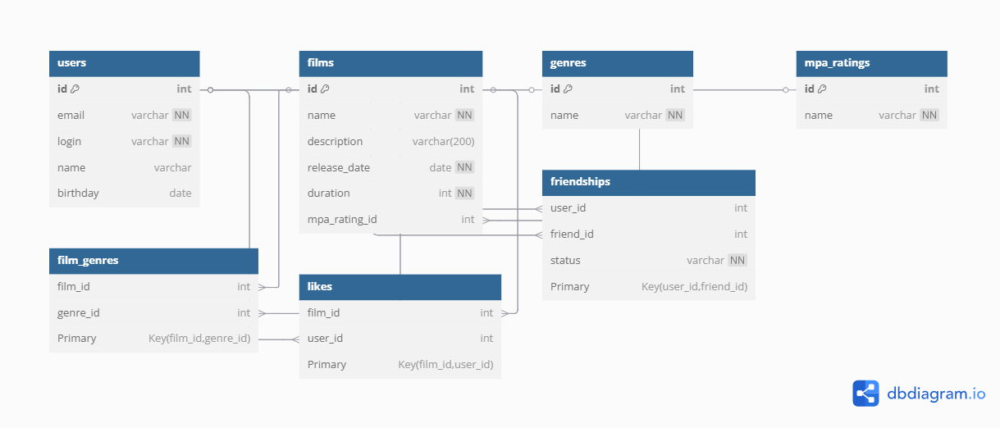

# Filmorate — сервис рекомендаций фильмов

**Backend для социальной сети по оценке и обсуждению кино (аналог Kinopoisk).**  
Проект включает сложную бизнес-логику рекомендаций, систему друзей и лайков, оптимизированную работу с реляционной базой данных.

---

## 🎬 Возможности

* **Система пользователей:** регистрация, профили, список друзей с подтверждением
* **Каталог фильмов:** добавление, поиск, фильтрация по жанрам и рейтингам MPA
* **Лайки и рейтинги:** пользователи оценивают фильмы, формируется топ популярных
* **Система друзей:** добавление в друзья, подтверждение, просмотр общих друзей
* **Рекомендации:** подборка фильмов на основе оценок друзей
* **Жанры и рейтинги:** расширенная система классификации контента

---

## 🛠 Технологии

* **Backend:** Java 11, Spring Boot
* **База данных:** PostgreSQL, H2 (тесты)
* **Доступ к данным:** Spring JDBC, JdbcTemplate
* **Сборка:** Maven
* **Тестирование:** JUnit, Mockito
* **Валидация:** Hibernate Validator
* **Документация:** OpenAPI 3.0 (Swagger)
* **Утилиты:** Lombok

---

## 🏃 Запуск проекта

### Требования
- Java 11+
- Maven 3.6+
- PostgreSQL 12+ (или Docker)

### Установка и запуск

1. **Клонирование и сборка:**
```bash
git clone https://github.com/Infern74/java-filmorate.git
cd java-filmorate
mvn clean package
Настройка базы данных:
```
```sql
-- Создание базы данных
CREATE DATABASE filmorate;
-- Далее запустить скрипт из schema.sql (если есть)
Настройка подключения к БД в application.properties:

properties
spring.datasource.url=jdbc:postgresql://localhost:5432/filmorate
spring.datasource.username=your_username
spring.datasource.password=your_password
```
### Запуск приложения:

```bash
mvn spring-boot:run
Запуск через Docker:
bash
docker-compose up -d  # если есть docker-compose.yml
```
* Приложение будет доступно по адресу: http://localhost:8080
* Swagger UI: http://localhost:8080/swagger-ui.html

## 🗄️ Структура базы данных
* Проект использует реляционную модель из 7 взаимосвязанных таблиц:

### Database Schema


[Interactive Diagram](https://dbdiagram.io/d/68596f21f039ec6d367ef618)

### Основные таблицы:
* users — информация о пользователях

* films — данные о фильмах

* genres — справочник жанров (Комедия, Драма и т.д.)

* mpa_ratings — возрастные рейтинги (G, PG, PG-13, R, NC-17)

* film_genres — связь фильмов и жанров (многие-ко-многим)

* likes — лайки пользователей фильмам

* friendships — система друзей со статусами (PENDING, CONFIRMED)

### Примеры ключевых SQL-запросов:
```sql
-- Топ-5 популярных фильмов
SELECT f.id, f.name, COUNT(l.user_id) AS likes_count
FROM films f
LEFT JOIN likes l ON f.id = l.film_id
GROUP BY f.id
ORDER BY likes_count DESC
LIMIT 5;

-- Общие друзья двух пользователей
SELECT u.* 
FROM friendships f1
JOIN friendships f2 ON f1.friend_id = f2.friend_id
JOIN users u ON f1.friend_id = u.id
WHERE f1.user_id = 123 
  AND f2.user_id = 456 
  AND f1.status = 'CONFIRMED'
  AND f2.status = 'CONFIRMED';
```

## 📁 Архитектура проекта
```
java-filmorate/
├── src/main/java/
│   └── ru/yandex/practicum/filmorate/
│       ├── controller/      # REST контроллеры
│       ├── model/          # Сущности (User, Film, Genre и т.д.)
│       ├── service/        # Бизнес-логика
│       ├── storage/        # Работа с БД (интерфейсы и реализации)
│       ├── dao/           # Data Access Objects
│       └── exception/     # Кастомные исключения
├── src/main/resources/
│   ├── schema.sql         # Скрипт создания таблиц
│   └── data.sql           # Начальные данные (жанры, рейтинги)
└── src/test/              # Тесты
```

## 🔧 Оптимизации и ключевые решения
### Сложные SQL-запросы оптимизированы с использованием:

* Составных индексов для таблиц связей

* EXPLAIN ANALYZE для анализа производительности

* Оптимальных JOIN вместо вложенных SELECT

### Архитектура данных:

* Нормализованная структура БД (3NF)

* Отсутствие избыточных данных

* Быстрые операции поиска по индексам

### Бизнес-логика:

* Кэширование часто запрашиваемых данных (жанры, рейтинги)

* Пакетные операции для массовых обновлений

* Валидация на уровне БД и приложения

### 📈 Производительность
* Время отклика API: < 50 мс для большинства endpoint'ов

* Обработка сложных запросов: < 200 мс (топ фильмов, общие друзья)

* Масштабируемость: архитектура позволяет добавлять шардирование БД при росте нагрузки

## 📚 Что я освоил в этом проекте
* ✅ Проектирование сложной схемы БД (7 взаимосвязанных таблиц)
* ✅ Оптимизация SQL-запросов для высоконагруженных операций
* ✅ Реализация бизнес-логики друзей, лайков, рекомендаций
* ✅ REST API с полным циклом CRUD операций
* ✅ Интеграционное тестирование с реальной БД
* ✅ Работа с Maven, настройка жизненного цикла сборки
